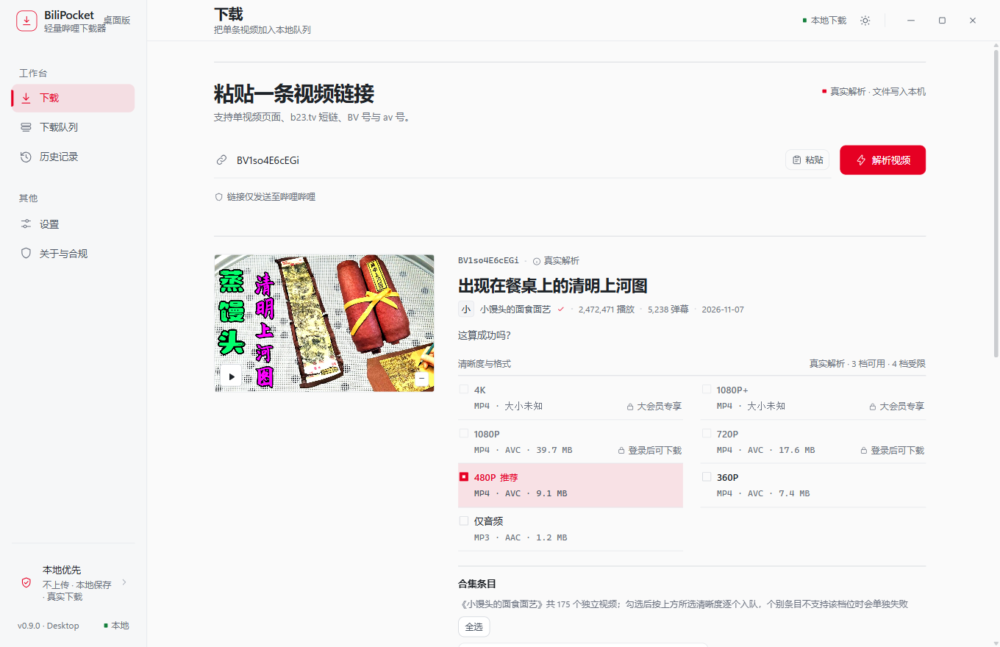
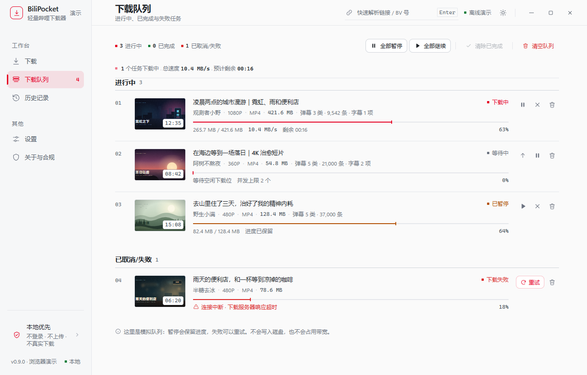
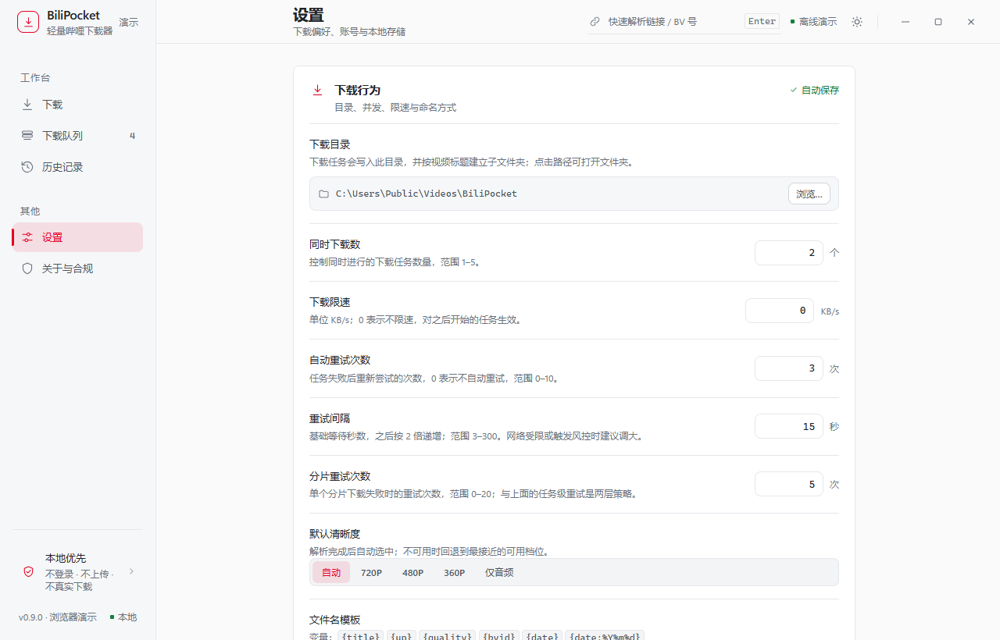
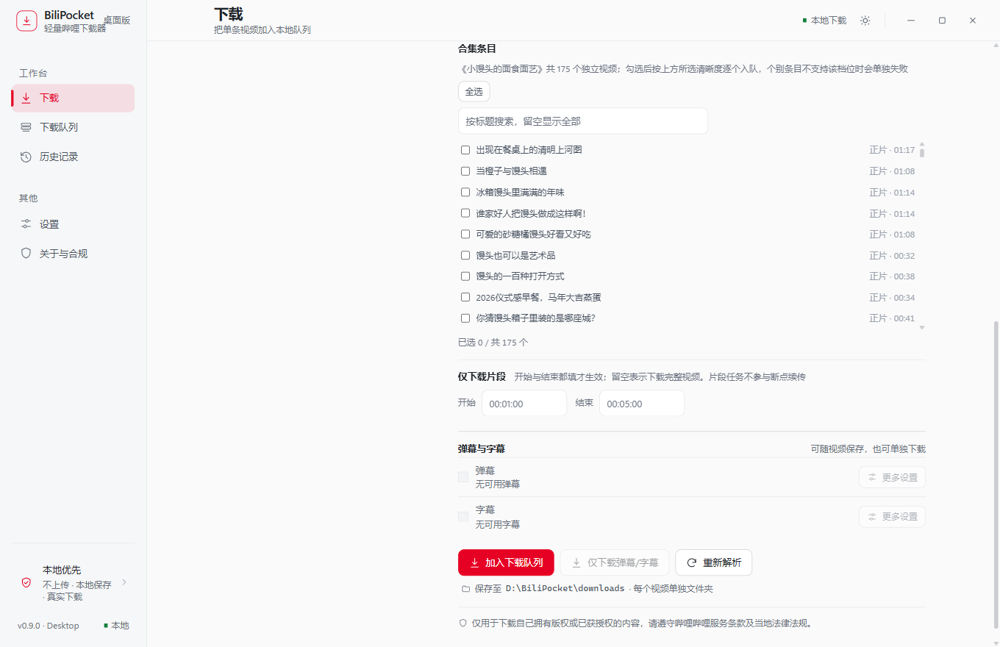
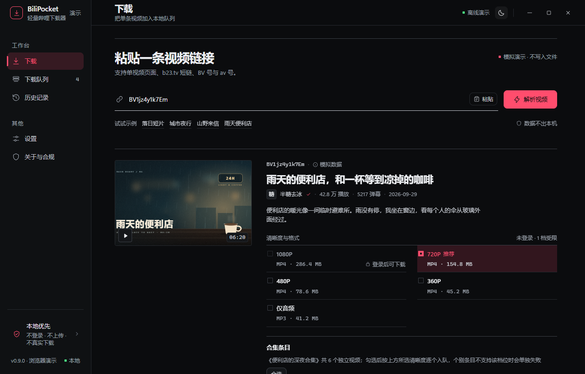

<p align="center">
  
</p>

<h1 align="center">BiliPocket</h1>

<p align="center">本地优先的哔哩哔哩下载器 · 下载、队列、后处理全在自己的机器上完成</p>

<p align="center">
  
  
  
  
</p>



---

## 项目简介

BiliPocket 是一个 Windows 桌面端的哔哩哔哩下载器。**不登录也能下公开内容，登录后只访问你账号本身已有的权限**——不包含会员绕过、DRM 破解或反爬规避。

技术上是一个 Tauri 2 应用：Rust 负责网络、队列、进程与落盘，前端是没有构建步骤的原生 ESM，直接由 WebView 加载。

**它做什么**

- 解析视频页、`b23.tv` 短链、BV 号与 av 号，列出真实可用的清晰度档位
- 把选中的视频加进队列，并发下载、断点续传、失败重试、随时暂停
- 下载完成后在本地补齐封面、字幕、弹幕、章节、NFO、多音轨

**它不做什么**

- 不遍历收藏夹、UP 主空间、番剧、排行榜、搜索页（这是定位约束，不是未实现）
- 不破解会员或付费内容，不做风控绕过
- 不上传任何数据，不需要账号体系之外的云端服务

## 功能特点

**解析**

- 视频页 / `b23.tv` 短链 / BV 号 / av 号，粘贴即可
- 清晰度矩阵取 `support_formats` 与当前会话 DASH 流求并集，未登录时灰显无权限档位并说明原因
- 同一 BV 下的分 P 用标准 `?p=N` 逐个入队；视频所属合集可在结果页按需勾选，**只解析一次，不产生列表翻页请求**

**下载**

- 队列支持并发数（1–5）、全局限速、优先级、全部暂停/继续
- 任务级重试（次数与退避可配）+ 分片级重试，命中 412 / -352 时按 30/90/180 秒退避
- 断点续传；任务级进度节流按并发数自适应，避免高频 IPC
- 片段下载（`HH:MM:SS` 区间），与断点续传互斥

**后处理**（只操作已落盘文件，失败不影响任务成功状态）

- 封面：`-poster.jpg` 或与视频同名，删除任务时一并清理
- 字幕：外挂 SRT / ASS，语言与格式可选
- 弹幕：按类型导出
- 章节：从 `view_points` 生成，MKV/MP4 统一走一次 ffmpeg 封装
- NFO：`movie` / `episodedetails` 双根节点，标题来源可选
- 多音轨：`--audio-multistreams`，只收带语言标签的轨道

**其它**

- 扫码登录，凭据存 Windows 凭据库；会话过期自动清理并提示
- 文件名模板支持 `{title}` `{up}` `{quality}` `{bvid}` `{date:格式}` `{p}` 等，统一清洗非法字符、Windows 保留名与超长路径
- 引擎自诊断（yt-dlp / ffmpeg 版本与可用性）、脱敏诊断包导出
- 托盘、单实例、窗口尺寸记忆、完成通知、暗色主题

## 界面

| 下载队列 | 设置 |
|---|---|
|  |  |

| 合集与下载选项 | 暗色主题 |
|---|---|
|  |  |

> 截图取自浏览器演示入口（`npm run dev:web`），其中的视频信息、封面与进度均为**演示数据**，不写入任何文件。

## 安装与使用

### 环境要求

| 依赖 | 版本 |
|---|---|
| Node.js | 18+ |
| Rust | stable（Windows 用 MSVC toolchain） |
| MSVC Build Tools | 打包 Windows 安装包时需要 |
| WebView2 Runtime | Windows 11 自带，Windows 10 可能需要手动安装 |

### 从源码运行

```bash
git clone https://github.com/guohong-gh/bilipocket.git bilipocket
cd bilipocket
npm install

# 桌面应用（会自动起静态服务并打开 Tauri 窗口）
npm run dev

# 仅浏览器预览（演示入口，改界面时更快）
npm run dev:web    # http://localhost:1420/dev/
```

> 两个命令都会占用 1420 端口。已经单独跑了 `dev:web` 时先停掉，否则 `npm run dev` 会报端口冲突。

> `npm run dev` 只启动窗口，不打包 bundle resources；未放置 sidecar 时界面可用，但解析与下载依赖的本地引擎不可用（debug 构建可使用临时引擎，见 `SECURITY.md`）。

### 打包

```bash
npm run build              # NSIS 安装包
npm run package:portable   # 便携 zip（禁用自动更新，手动替换版本）
```

> 干净克隆未放置引擎时，上面两条命令会因缺少 bundle resource 失败，CI 中对应步骤已自动跳过。当前没有可下载的 Release 安装包，克隆源码后需先按下方说明放置引擎，才能产出可运行程序。

sidecar 可执行文件（yt-dlp / ffmpeg）不入库，首次构建或首次推送前需按 `src-tauri/binaries/ENGINE_MANIFEST.json` 人工放到位，`npm run verify:sidecars` 会校验 SHA-256。干净克隆未放置引擎时，`.github/workflows/verify.yml` 会自动跳过依赖 sidecar 的 E2E、打包与产物上传步骤，其余检查照常运行；`release.yml` 在打 tag 时仍要求引擎就位。

> **[待确认 T4]** 两个 exe 均为定制构建（PyInstaller one-file / gyan.dev essentials），清单里只有来源首页与 SHA-256，**没有可直接下载的直链**，仓库内也没有 provision 脚本。已决定先推送源码、托管形态日后补齐；仓库因此不含任何二进制，CI 的打包链路在干净克隆上保持跳过。手工放置时按 `src-tauri/binaries/ENGINE_MANIFEST.json` 的文件名与 SHA-256 就位，再用 `npm run verify:sidecars` 校验。详见下方「待确认事项」表。

### 首次启动

1. 选择下载目录（可跳过，用默认目录）
2. 可选扫码登录——不登录也能下载公开、免费内容
3. 粘贴链接 → 选清晰度 → 加入队列

## 目录结构

```text
.
├─ src/                       前端（无构建步骤，Tauri 直接加载）
│  ├─ index.html              页面骨架
│  ├─ js/
│  │  ├─ app.js               入口装配：import + 首启引导 + 启动序列（约 180 行）
│  │  ├─ app/                 21 个功能模块，见下表
│  │  ├─ catalog.js           清晰度 / 账号档位 / 弹幕类型 / 字幕语言的静态目录与纯函数
│  │  ├─ settings-schema.js   设置项单一事实源（21 字段 + 归一/patch/wire）
│  │  ├─ store-desktop.js     桌面 store：把界面动作翻译成 Rust 命令
│  │  ├─ bridge.js runtime.js 平台判定与 store 选择
│  │  └─ ui.js tauri.js       通用组件与窗口能力封装
│  ├─ styles/                 设计令牌、组件、页面样式
│  └─ assets/
├─ src-tauri/                 Rust 后端
│  ├─ src/
│  │  ├─ commands.rs          Tauri 命令入口
│  │  ├─ queue.rs             任务调度、并发、重试、进度事件
│  │  ├─ engine/              yt-dlp 封装与输出解析
│  │  ├─ bilibili.rs          view/player 接口、WBI 签名、合集解析
│  │  ├─ auth.rs              扫码登录、凭据读写（Windows 凭据库）
│  │  ├─ db.rs                SQLite 持久化与版本迁移
│  │  ├─ files.rs             路径围栏、文件名清洗、sidecar 清理
│  │  ├─ postprocess.rs       封面/字幕/章节/NFO 的后处理编排
│  │  └─ domain.rs            领域模型与校验
│  ├─ binaries/               sidecar（*.exe 不入库，清单入库）
│  └─ tauri.conf.json         CSP、asset 作用域、打包配置
├─ dev/                       浏览器演示入口（mock store + 演示数据）
├─ tests/
│  ├─ unit/                   node:test 纯函数测试
│  └─ ui/                     Playwright 界面回归
├─ scripts/                   构建、校验、桌面端到端脚本
├─ docs/                      排查手册、跨平台评估、截图
├─ LICENSES/                  第三方（yt-dlp / FFmpeg）许可与清单
└─ RELEASE.md SECURITY.md     发布清单与安全说明
```

**前端模块分层**（`src/js/app/`）

| 层 | 模块 |
|---|---|
| 状态 | `parse-store.js` `dom.js` |
| 纯渲染 | `format.js` `quality-picker.js` `season-panel.js` `advanced-options.js` |
| 视图 | `result-view.js` `queue-view.js` `history-view.js` `home-view.js` `settings-view.js` |
| 交互 | `selection.js` `action-bar.js` `enqueue.js` `download-parse.js` |
| 外壳 | `router.js` `chrome.js` `shell.js` `platform.js` `theme.js` |
| 账号 | `auth.js` |

模块之间允许循环导入：函数声明在模块实例化阶段就已就绪，而所有调用都发生在加载之后。

## 技术栈

- **外壳**：Tauri 2 + Rust stable
- **后端**：tokio、reqwest、rusqlite、keyring、serde、md-5 / sha2（WBI 签名）
- **前端**：原生 ESM + CSS，无打包器、无框架；`tsc --noEmit` 做类型检查
- **测试**：`cargo test`、`node:test`、Playwright（Edge channel）

## 开发与测试

| 命令 | 作用 |
|---|---|
| `npm run typecheck` | 前端类型检查（`jsconfig.json` 是显式白名单） |
| `npm run test:unit` | 前端纯函数测试 |
| `npm run test:ui` | Playwright 界面回归 |
| `npm run test:desktop` | 隔离数据目录的 WebView2 端到端 |
| `npm run verify:privacy` | 校验生产源码不含演示数据与示例封面 |
| `npm run verify:sidecars` | 校验 sidecar 版本与 SHA-256 |
| `cargo test --lib` | Rust 单元测试 |

当前基线：`cargo test --lib` 123 通过 / 2 忽略、`clippy` 源码零告警、`tsc` 零错误、前端单测 42 项、Playwright 18 项。

## 下载产物的文件布局

```text
<下载目录>/
└─ 视频标题/                    每个视频一个文件夹
   ├─ 视频标题 [1080P].mp4
   ├─ 视频标题-poster.jpg       封面（可选）
   ├─ 视频标题.zh-CN.ass        字幕（可选，按语言一个文件）
   ├─ 视频标题.nfo              NFO（可选）
   └─ 视频标题-弹幕/           弹幕（可选，按类型分文件）
```

删除任务时勾选「删除文件」会一并清理 sidecar；视频文件夹只在为空时移除，**下载根目录永远不会被删除**。

## 合规与边界

- 仅用于你拥有或已获授权的内容；请遵守哔哩哔哩的服务条款与当地法律
- 不含 DRM 破解、付费内容绕过、反爬规避；命中风控只做识别、退避与提示
- 与哔哩哔哩官方无关
- 内置 FFmpeg 为 GPL 构建，以独立进程调用，许可与来源见 [`LICENSES/THIRD_PARTY.md`](LICENSES/THIRD_PARTY.md)

## 已知限制

- **仅支持 Windows**。非 Windows 平台当前无法编译，跨平台评估结论与代价见 [`docs/CROSS_PLATFORM_ASSESSMENT.md`](docs/CROSS_PLATFORM_ASSESSMENT.md)
- 未签名发布，首次运行可能触发 SmartScreen 提示；未配置更新源时自动更新区域会自动隐藏
- 高频解析或并发下载可能触发平台访问频率校验，此时靠退避重试，没有主动的请求间隔下限
- 章节写入需要 ffmpeg 二次封装，大文件会多花一些时间
- 浏览器入口（`dev/`）是纯模拟：不能选目录、不能发通知，也不写任何文件
- 窗口状态只记忆尺寸与最大化，不恢复窗口位置

## 贡献

欢迎 issue 与 PR。提交前请先读 [`CONTRIBUTING.md`](CONTRIBUTING.md)，并确保以下命令全绿：

```bash
npm run typecheck && npm run test:unit && npm run test:ui
cd src-tauri && cargo test --lib && cargo clippy --lib --tests
```

## 许可证

源代码采用 [MIT](LICENSE)。随包分发的 yt-dlp（The Unlicense）与 FFmpeg（GPL-3.0）保留各自许可，详见 [`LICENSES/THIRD_PARTY.md`](LICENSES/THIRD_PARTY.md)。

## 待确认事项（首次公开前）

> 以下条目无法由仓库内容自动确定，已在对应位置用 `[待确认 Tn]` 就地标注。填写后请删除该标记与表中对应行。已销项 T1、T2、T3、T8、T10、T11、T12；T4 已决定「先推送后补」，具体托管形态仍待定。

| 编号 | 事项 | 当前值 / 位置 | 未确认的后果 |
|---|---|---|---|
| T4 | **sidecar 托管形态**（已决定先推送后补；入库 / Git LFS / Release asset / 构建时供给待选） | `src-tauri/binaries/ENGINE_MANIFEST.json`（仅首页与哈希，无直链）、上文打包说明、`RELEASE.md` §4 | 干净克隆无法一键打包、CI 打包链路跳过；不阻塞推送源码 |
| T5 | CI secrets：`WINDOWS_CERTIFICATE*` / `TAURI_SIGNING_PRIVATE_KEY*` | `.github/workflows/release.yml` | 签名发布不可用 |
| T6 | updater 公私钥是否配对、私钥口令 | `src-tauri/tauri.conf.json` 的 `plugins.updater.pubkey` | 更新包签名无法验证 |
| T7 | GPL-3.0 FFmpeg 分发合规（完整对应源码 / 书面要约 / H.264·AAC 专利）或改用 LGPL 构建 | `RELEASE.md` §1、`LICENSES/THIRD_PARTY.md` | 不阻塞推送源码；阻塞把二进制入库或发布 Release |
| T9 | Rust crates 完整依赖许可清单 | `LICENSES/THIRD_PARTY.md` | 第三方许可不完整 |

---

<p align="center"><sub>BiliPocket 与哔哩哔哩无关联。请仅下载你有权获取的内容。</sub></p>
